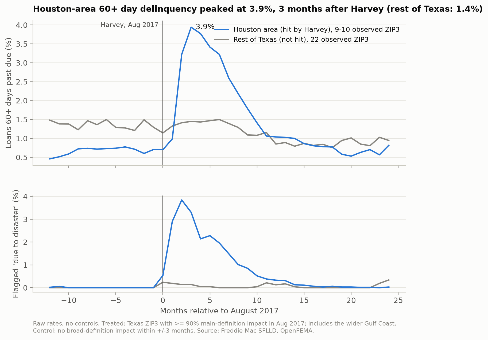

# Is Climate Risk Priced in Mortgage Credit?



Raw Houston-area 60+ day delinquency rose from 0.70% in August 2017 to 3.94%
three months later, compared with 1.14% to 1.45% in the Texas comparison group.
These are descriptive rates; the causal event study is in progress.

Work in progress: a reproducible pipeline combining 1.05 million Freddie Mac loans
(62 million loan-months), FEMA disaster declarations and Census housing data.
See [the exploratory figures and source tables](reports/eda.md).

## Reproduce

Install [uv](https://docs.astral.sh/uv/getting-started/installation/), then run:

```sh
make setup
make check
```

Python 3.12 is selected by `.python-version`. Dependencies are pinned in `uv.lock`.
Phase 1 uses DuckDB, Polars, PyArrow, PyYAML and openpyxl. Development tools include
pytest, Ruff, pre-commit and ipykernel. Later modeling libraries will be added as needed.

## Data access

Register for [Freddie Mac Clarity](https://capitalmarkets.freddiemac.com/clarity)
to access the [Single-Family Loan-Level Dataset](https://www.freddiemac.com/research/datasets/sf-loanlevel-dataset).
Place the 2004-2024 sample files in `data/raw/freddie/`:
`sample_orig_YYYY.txt` and `sample_perf_YYYY.txt`.
Reference documents belong in `data/raw/freddie/docs/`.
Data is not redistributed in this repository and retains its original terms.

The [HUD-USPS crosswalk page](https://www.huduser.gov/portal/datasets/usps_crosswalk.html)
provides registration and API access instructions for a potential geographic mapping source.
Geographic allocation remains subject to validation; Freddie Mac samples expose ZIP3 only.
Keep credentials in an ignored local `.env` file and downloads under `data/`.

## Ingestion and quality checks

```sh
uv run --frozen python -m climrisk.ingest.freddie --years 2005
make data
```

`make data` ingests every available source year and runs quality checks.
Outputs are ZSTD-compressed Parquet files under
`data/interim/freddie/{origination,performance}/YYYY.parquet`.
Filenames retain the source year. Every row carries identifier-derived `vintage`
and `orig_quarter`, plus `source_year` for traceability (decision D003).

The YAML schema defines strict types, monthly dates and unknown-value sentinels.
Whitespace and missing codes become NULL before conversion. Categorical codes and
ZIP3 remain text. Monthly dates use the first day of the month.
Each output is written to a temporary file and atomically renamed; temporary files
are cleaned up on errors. Rerunning replaces existing outputs. Atomicity applies
to each file, not the whole run.

Validation writes aggregate statistics to `reports/data_quality.md`.
Blocking failures cause a nonzero exit status; warnings remain visible for review.
Data and the virtual environment are excluded from Git.

## Project structure

- `configs/`: source schemas, future split dates and method parameters.
- `data/{raw,interim,processed}/`: local data, entirely excluded from Git.
- `src/climrisk/ingest/`: Freddie Mac ingestion and validation; FEMA and Census ingestion; crosswalk and FRED placeholders.
- `src/climrisk/features/`: loan default targets, ZIP3-month panels and an exposure placeholder.
- `src/climrisk/causal/`: event study and pricing placeholders.
- `src/climrisk/models/`: scorecard, GBM, calibration and evaluation placeholders.
- `src/climrisk/stress/`: scenario and expected loss placeholders.
- `notebooks/`: exploration only, with `01_`, `02_`, etc. filename prefixes.
- `tests/`: synthetic-data transformation tests and repository safeguards.
- `reports/`: figures, aggregate quality report and LaTeX report skeleton.

`make all` runs ingestion, validation and feature construction, then prints TODO
messages for the remaining pipeline stages. It does not yet run a complete research pipeline.
Methodological choices and unresolved questions are recorded in `DECISIONS.md`.

## Development

Use `make test`, `make lint` and `make format`.
Pre-commit checks lint, formatting, trailing whitespace, final newlines and newly
added files larger than 1000 KB. The size guard does not detect all sensitive data;
keep `data/` ignored and review staged changes.
VS Code defaults to `.venv/bin/python`; select it explicitly if an old interpreter persists.
Conda automatic base activation is disabled locally; an existing terminal may still
need `deactivate` followed by `conda deactivate`.

## License

Code is licensed under MIT. Source datasets retain their own access and licensing terms.

## Phase 2: targets and panel

```sh
make features
```

`configs/target.yaml` defines the observation horizon, default and exit codes,
data cutoff and COVID exclusion window. This produces:

- `data/processed/loans.parquet`: all loans, first terminal events, outcome,
  `default_24m`, exclusion flags and `in_pd_sample`.
- `data/processed/zip3_month.parquet`: additive loan and delinquency counts,
  payoff/loss exits, disaster delinquency, forbearance and current UPB.
- `reports/target_summary.md`: aggregate outcomes, vintage default rates and exclusions.

PD estimation uses labelled loans without HARP, date anomalies, COVID overlap or
unknown ZIP3. The panel retains COVID months for later analysis-time restrictions.
Every label requires a window ending on or before the cutoff, even for early defaults
or payoffs, to avoid recent-vintage selection bias.
Prepayment is a competing non-default outcome; transfers and incomplete windows are
censored. Events after the cutoff cannot affect labels. Internal missing months are counted; loans observed at or after window end may
be labelled performing despite gaps. Leading gaps are tolerated; internal runs longer than two months set
`long_internal_gap` and exclude only loans labelled 0 from the PD sample (D006).
Observed defaults remain eligible subject to the other sample restrictions.
The threshold is configured in `configs/target.yaml`. Exits use `zero_balance_date` (reporting month as fallback), with
the latest non-null exit code selected by reporting month. Earlier exits take
precedence over later observed default statuses (D004-D005).
Do not use outcome, event-date or other post-origination fields as model predictors.

## Phase 3: climate data

No registration or API key is required. The pipeline downloads the public Census
2010 ZCTA-to-county relationship file and uses HUPT housing counts directly.
Cached downloads are reused; ingestion CLIs accept `--refresh`.

```sh
uv run --frozen python -m climrisk.ingest.fema
uv run --frozen python -m climrisk.ingest.census
uv run --frozen python -m climrisk.features.climate
```

`make data` includes FEMA and Census ingestion; `make features` includes climate
construction. Source URLs and event definitions are in `configs/climate.yaml`.
Outputs are `data/processed/zip3_county_weights.parquet` and
`data/processed/zip3_month_climate.parquet`, with an aggregate report in
`reports/climate_summary.md`.

The main disaster definition requires household assistance; the broad definition
adds storm types without that requirement. Exposure sums weighted events over the
120-month window ending four months before the measurement month (D011). Housing weights use Census 2010
HUPT housing counts for each ZCTA-county part. Static 2010 weights and revised
FEMA declarations remain retrospective inputs; see D002 and D009-D010 for limitations.
NRI is reserved for a potential later robustness analysis.

## Exploratory figures (Phase 4)

Run `make report` after `make features` to generate five PNG figures and their
aggregate source tables in `reports/eda.md`. The annual disaster figure also reads
`data/interim/fema/declarations.parquet` to count each county once per year.
The Harvey comparison uses Texas ZIP3 with at least 90% main-definition impact in
August 2017, against Texas ZIP3 with no broad-definition impact within three months
before or after the event. These are descriptive comparisons, without causal controls.
