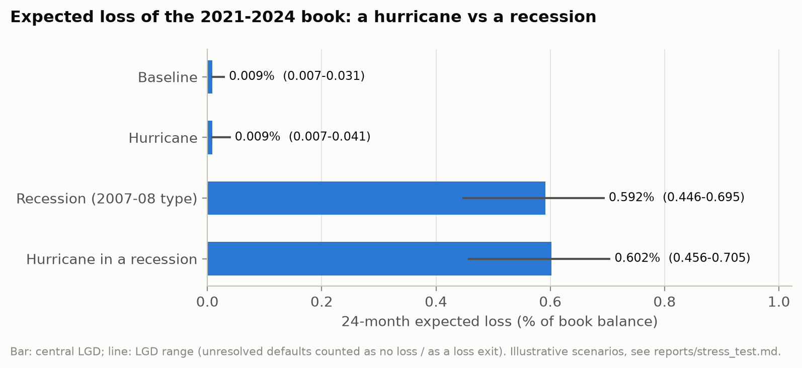
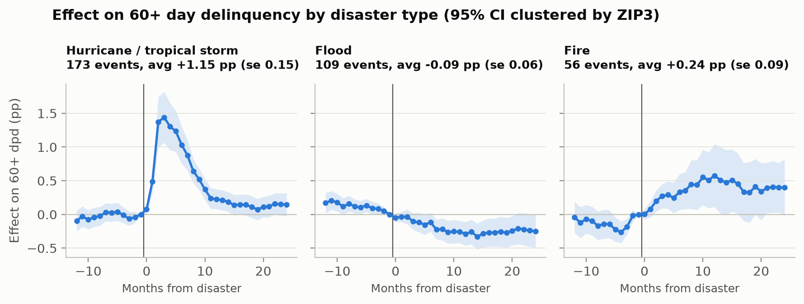

# Is Climate Risk Priced in Mortgage Credit?

**Causal evidence, pricing, PD modelling and a stress test on 1.05M Freddie Mac loans (2004–2024)**

Hurricanes make mortgage borrowers miss payments, but do they make lenders lose money? This
project combines Freddie Mac loan-level data with FEMA disaster declarations and Census
geography to answer that question end to end: from a causal event study to the pricing of
coastal risk, an out-of-time probability-of-default (PD) model, measured loss given default
(LGD) and an expected-loss stress test.

📄 **Full report (IEEE format, 6 pages):** [reports/report.pdf](reports/report.pdf)



## Key findings

1. **Hurricanes cause a short delinquency spike.** In a stacked event study with 338 treated ZIP3-events
   (173 hurricane / tropical-storm ZIP3-events), hurricanes raise 60+ day delinquency by **+1.15 pp (≈ +42%)** in
   the six months after the event month. The effect fades within about a year. Flood estimates fail
   the pre-trend tests and are not interpreted causally.
2. **Those defaults rarely become losses.** Disaster-flagged defaults frequently return to current status or are paid off;
   modifications and payment deferrals are also observed:
   - over 24 months, 1% of disaster-flagged defaults end in a loss, versus 16% of other
     defaults;
   - measured over 5 years, their LGD is **0.04%** versus **2.8%** for other defaults of the
     same era.
3. **Coastal loans carry a small rate premium.** At equal FICO, LTV and DTI, within the same state and
   month, loans near the hurricane coast default about **26%** more often. This holds both
   before and after 2012. They pay a **~2 bp** rate premium. A precise comparison with expected credit loss remains sensitive to
   the LGD and horizon assumptions.
4. **Static climate features show no incremental test ranking gain.** In a pre-registered out-of-time
   test (selection on 2004–2018, refit on 2004–2018, test 2021–2024), static climate features show **no demonstrated gain** in discriminatory
   power to the PD model: an AUC change of −0.0002 [−0.0008, +0.0003]. This holds with both
   default definitions.
5. **A recession dwarfs a hurricane.** On the $35 bn 2021–2024 book:
   - a 2008-type recession raises 24-month expected loss to **0.59%** of balance, ≈ 67 times
     the baseline;
   - a simultaneous hurricane hit on every coastal ZIP3, under deliberately severe
     assumptions, adds **0.0001%** of balance (**0.0102%** under the high disaster-LGD
     scenario). This is a scenario result, not an upper bound on possible hurricane losses:
     even at the high disaster LGD, the hurricane's default effect would have to be 57 times
     larger (about 65% extra default probability for fully coastal loans) to match the recession.

**Scope.** These results cover the lender's or guarantor's credit loss over 24 months under
current servicing practices. Property damage, insurance costs and long-run coastal
house-price risk are out of scope.

## Results in figures

| | |
|---|---|
|  |  |
| Effect of disasters on 60+ day delinquency, by type | Coastal exposure: conditional associations with rates and default |
|  |  |
| Through-the-cycle PD vs observed default, by vintage | Expected loss by scenario |

## Methods

| Phase | What | Report |
|---|---|---|
| 1–2 | Ingestion, validation, 24-month default target (90+ days, REO or loss exit), censoring and selection-bias controls | `reports/data_quality.md`, `reports/target_summary.md` |
| 3 | FEMA declarations mapped to ZIP3 with 2010 Census housing weights; ex-ante exposure with an availability lag | `reports/climate_summary.md` |
| 4 | Exploratory analysis | `reports/eda.md` |
| 5 | Stacked event study (clean controls, Census-division × period fixed effects, ZIP3-clustered SE, mean and slope pre-trend tests validated by Monte Carlo); cure analysis | `reports/event_study.md`, `reports/event_study_robustness.md` |
| 6 | Spread over the PMMS rate and 24-month default, regressed on climate exposure and hurricane-coast distance (TIGER coastline) | `reports/pricing.md` |
| 7 | PD model: WoE scorecard (IV, correlation and sign-based selection) vs LightGBM; calibration; through-the-cycle anchoring; climate ablation with paired bootstrap; pre-registered test evaluation; credit-default sensitivity | `reports/pd_*.md`, `reports/credit_default.md` |
| 8 | LGD from Freddie Mac loss data, with bounds for unresolved defaults; EL = PD × LGD × EAD stress scenarios | `reports/lgd.md`, `reports/stress_test.md` |

Every modelling choice is recorded, with its reason, in [`DECISIONS.md`](DECISIONS.md)
(D001–D025).

## How this project guards against fooling itself

- **Pre-registration.** The final PD models and the alternative default definition were
  committed before the test vintages were evaluated (D021, D022). Two validation results
  did not replicate on test, and both are reported:
  - the climate gain;
  - the scorecard's parity with LightGBM. LightGBM wins out of time by +0.015 AUC.
- **Out-of-time evaluation only.** The data is split by vintage, never at random. The final model choice was fixed before test evaluation; subsequent sensitivity
  analyses are reported separately.
- **Leakage controls.** Features are known at origination. Exposure excludes recent event months using a three-month availability lag.
  Current FEMA records and static Census weights make this a retrospective analysis,
  not a reconstruction of information actually available at origination.
- **Selection-bias checks.** Censoring rules apply to every loan, not only to defaults.
- **Honest uncertainty.**
  - Bootstrap intervals are reported, with their limit: they resample loans, not ZIP3.
  - LGD comes with low and high scenario estimates, not confidence intervals.
  - Stress assumptions are explicit in `configs/stress.yaml`.
- **Bugs found by reading the numbers are fixed and documented.** For example, quantile
  binning collapsed zero-inflated features into a single bin.

## Data

The raw data is not redistributed. Download it into `data/raw/` (git-ignored):

| Source | What | Where |
|---|---|---|
| Freddie Mac Single-Family Loan-Level Dataset | Sample files 2004–2024 (origination + monthly performance), free registration | `data/raw/freddie/` |
| FEMA OpenFEMA | Disaster Declarations Summaries | downloaded by `make data` |
| U.S. Census Bureau | 2010 ZCTA–county relationship file; 2020 county boundaries; TIGER 2020 coastline | downloaded by `make data` / `make features` |
| FRED (Freddie Mac PMMS) | `MORTGAGE30US`, weekly 30-year mortgage rate | `data/raw/fred/` |

## Reproduce

```bash
uv sync --frozen             # Python 3.12 environment from uv.lock
make all                    # data -> features -> causal -> models -> risk -> report
uv run --frozen pytest -q   # 91 tests
```

Each step also runs alone, e.g. `uv run --frozen python -m climrisk.models.final`. The
reports in `reports/` are regenerated by the pipeline.

## Repository layout

```
configs/            all parameters (one YAML per phase)
src/climrisk/
  ingest/           Freddie Mac, FEMA, Census, FRED loaders and validation
  features/         target, panel, climate exposure, coast, PD features, credit default
  causal/           event study, robustness, pricing regressions
  models/           scorecard, LightGBM, calibration, TTC, ablation, final test, sensitivity
  risk/             LGD and stress test
  viz/              shared plotting style
tests/              unit and synthetic-data tests (known effects must be recovered)
reports/            generated reports and figures
DECISIONS.md        decision log
```

## Limitations

- **The PD model has no macroeconomic variables.** Its through-the-cycle PD under-predicts
  the eligible 2021–2023 test sample, by ×1.95 for D004 defaults and ×1.41 for credit
  defaults (D022).
- **The disaster LGD rests on few events:** about 180 resolved disaster-flagged defaults.
- **The causal results are about hurricanes.** Flood effects are not identified.
- **Pricing and PD results are conditional associations,** not causal effects.
- **Intervals ignore spatial dependence** between loans of the same ZIP3.

## Author

Moncef Hafiz, MSc Data Science, EPFL (minor in Financial Engineering).
