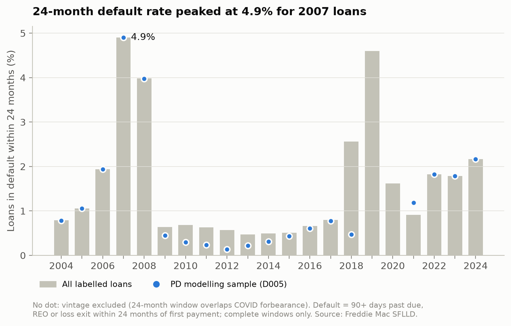
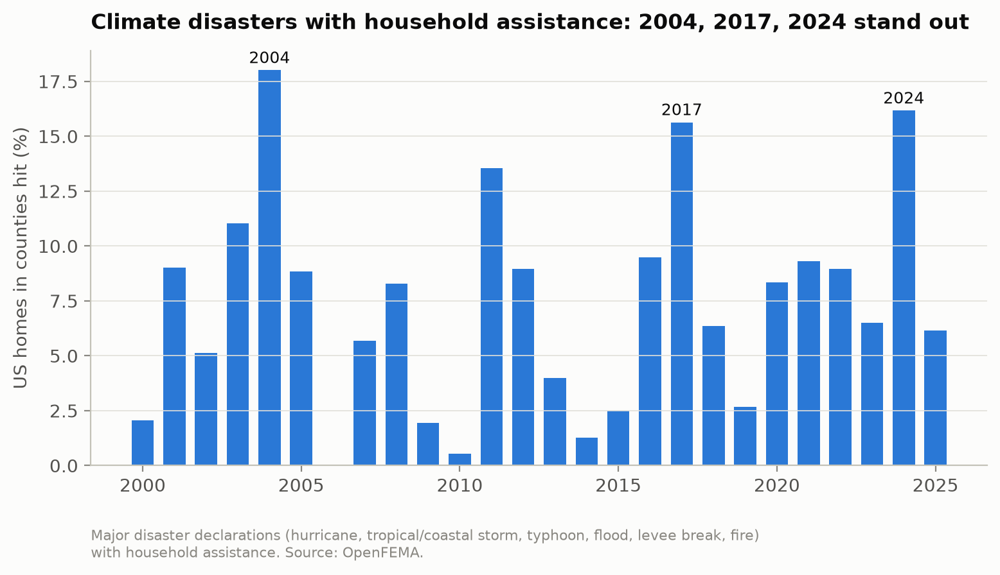
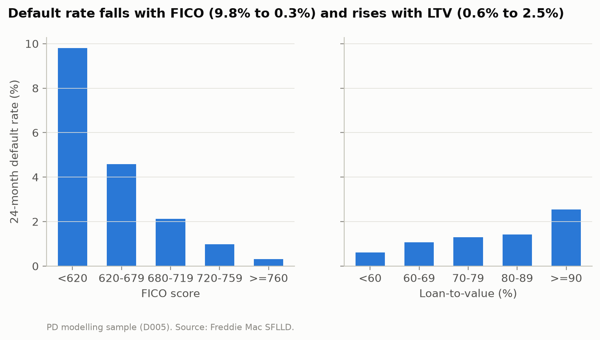
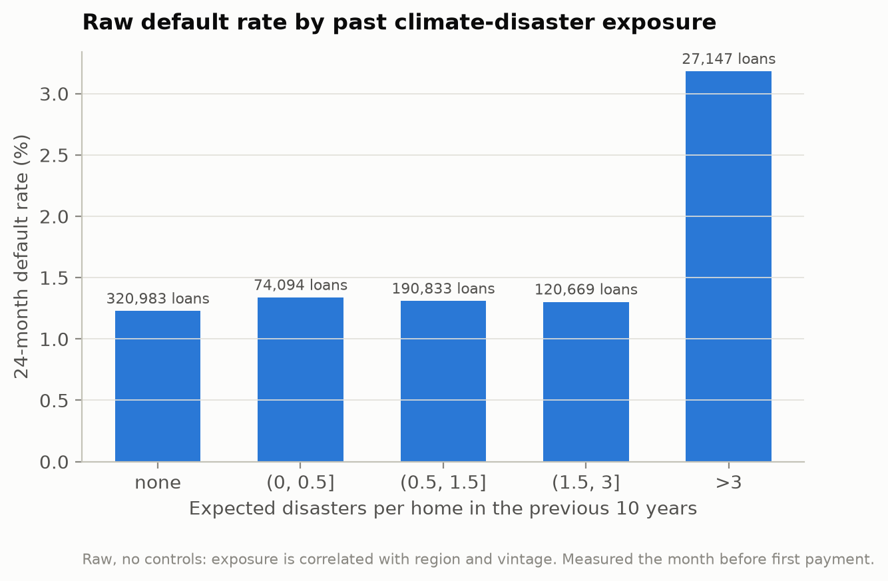

# Exploratory analysis

Generated by `python -m climrisk.viz.eda`. Raw descriptive patterns; causal estimates come from the event study (Phase 5).

## 1. Default rate by vintage

| vintage | labelled | defaults | default_rate_pct | covid_window | pd_loans | pd_default_rate_pct |
|---|---|---|---|---|---|---|
| 2004 | 49935 | 394 | 0.79 | False | 49860 | 0.78 |
| 2005 | 49939 | 526 | 1.05 | False | 49890 | 1.05 |
| 2006 | 49930 | 968 | 1.94 | False | 49891 | 1.93 |
| 2007 | 49919 | 2449 | 4.91 | False | 49875 | 4.90 |
| 2008 | 49891 | 1986 | 3.98 | False | 49865 | 3.98 |
| 2009 | 49898 | 317 | 0.64 | False | 44542 | 0.45 |
| 2010 | 49930 | 343 | 0.69 | False | 35307 | 0.30 |
| 2011 | 49898 | 316 | 0.63 | False | 34449 | 0.23 |
| 2012 | 49897 | 284 | 0.57 | False | 32520 | 0.14 |
| 2013 | 49930 | 234 | 0.47 | False | 35551 | 0.22 |
| 2014 | 49913 | 247 | 0.49 | False | 42618 | 0.31 |
| 2015 | 49953 | 253 | 0.51 | False | 45927 | 0.43 |
| 2016 | 49930 | 330 | 0.66 | False | 47400 | 0.61 |
| 2017 | 49896 | 397 | 0.80 | False | 48018 | 0.77 |
| 2018 | 49869 | 1279 | 2.56 | True | 3405 | 0.47 |
| 2019 | 49875 | 2292 | 4.60 | True | 0 |  |
| 2020 | 49876 | 807 | 1.62 | True | 0 |  |
| 2021 | 49886 | 456 | 0.91 | True | 7934 | 1.18 |
| 2022 | 49737 | 908 | 1.83 | False | 49735 | 1.83 |
| 2023 | 49719 | 886 | 1.78 | False | 49719 | 1.78 |
| 2024 | 7434 | 161 | 2.17 | False | 7434 | 2.17 |

## 2. Climate disasters by year

| year | homes_hit_pct |
|---|---|
| 2000 | 2.05 |
| 2001 | 9.02 |
| 2002 | 5.12 |
| 2003 | 11.02 |
| 2004 | 18.01 |
| 2005 | 8.84 |
| 2006 | 0.00 |
| 2007 | 5.70 |
| 2008 | 8.30 |
| 2009 | 1.93 |
| 2010 | 0.53 |
| 2011 | 13.55 |
| 2012 | 8.96 |
| 2013 | 4.00 |
| 2014 | 1.28 |
| 2015 | 2.51 |
| 2016 | 9.49 |
| 2017 | 15.64 |
| 2018 | 6.37 |
| 2019 | 2.68 |
| 2020 | 8.34 |
| 2021 | 9.30 |
| 2022 | 8.95 |
| 2023 | 6.50 |
| 2024 | 16.17 |
| 2025 | 6.17 |

## 3. Delinquency around Hurricane Harvey

| group | rel_month | dlq60_pct | disaster_dlq_pct | loan_months | zip3_areas |
|---|---|---|---|---|---|
| Houston area (hit by Harvey) | -12 | 0.46 | 0.02 | 5227 | 10 |
| Houston area (hit by Harvey) | -11 | 0.51 | 0.06 | 5251 | 10 |
| Houston area (hit by Harvey) | -10 | 0.59 | 0.00 | 5260 | 10 |
| Houston area (hit by Harvey) | -9 | 0.72 | 0.00 | 5261 | 10 |
| Houston area (hit by Harvey) | -8 | 0.74 | 0.00 | 5287 | 10 |
| Houston area (hit by Harvey) | -7 | 0.72 | 0.00 | 5306 | 10 |
| Houston area (hit by Harvey) | -6 | 0.73 | 0.00 | 5350 | 10 |
| Houston area (hit by Harvey) | -5 | 0.74 | 0.00 | 5402 | 10 |
| Houston area (hit by Harvey) | -4 | 0.77 | 0.00 | 5424 | 10 |
| Houston area (hit by Harvey) | -3 | 0.71 | 0.00 | 5465 | 10 |
| Houston area (hit by Harvey) | -2 | 0.60 | 0.00 | 5480 | 10 |
| Houston area (hit by Harvey) | -1 | 0.70 | 0.00 | 5535 | 10 |
| Houston area (hit by Harvey) | 0 | 0.70 | 0.54 | 5567 | 10 |
| Houston area (hit by Harvey) | 1 | 0.99 | 2.90 | 5578 | 10 |
| Houston area (hit by Harvey) | 2 | 3.22 | 3.85 | 5617 | 9 |
| Houston area (hit by Harvey) | 3 | 3.94 | 3.30 | 5659 | 9 |
| Houston area (hit by Harvey) | 4 | 3.77 | 2.14 | 5700 | 9 |
| Houston area (hit by Harvey) | 5 | 3.41 | 2.28 | 5741 | 9 |
| Houston area (hit by Harvey) | 6 | 3.22 | 1.96 | 5773 | 9 |
| Houston area (hit by Harvey) | 7 | 2.60 | 1.49 | 5780 | 9 |
| Houston area (hit by Harvey) | 8 | 2.18 | 1.01 | 5818 | 9 |
| Houston area (hit by Harvey) | 9 | 1.79 | 0.85 | 5882 | 9 |
| Houston area (hit by Harvey) | 10 | 1.41 | 0.52 | 5958 | 9 |
| Houston area (hit by Harvey) | 11 | 1.06 | 0.38 | 6022 | 9 |
| Houston area (hit by Harvey) | 12 | 1.04 | 0.33 | 6073 | 9 |
| Houston area (hit by Harvey) | 13 | 1.03 | 0.31 | 6133 | 9 |
| Houston area (hit by Harvey) | 14 | 1.00 | 0.13 | 6207 | 9 |
| Houston area (hit by Harvey) | 15 | 0.86 | 0.11 | 6271 | 9 |
| Houston area (hit by Harvey) | 16 | 0.80 | 0.06 | 6336 | 9 |
| Houston area (hit by Harvey) | 17 | 0.78 | 0.03 | 6398 | 9 |
| Houston area (hit by Harvey) | 18 | 0.77 | 0.06 | 6460 | 9 |
| Houston area (hit by Harvey) | 19 | 0.58 | 0.03 | 6549 | 9 |
| Houston area (hit by Harvey) | 20 | 0.53 | 0.03 | 6596 | 9 |
| Houston area (hit by Harvey) | 21 | 0.63 | 0.01 | 6670 | 9 |
| Houston area (hit by Harvey) | 22 | 0.70 | 0.01 | 6684 | 9 |
| Houston area (hit by Harvey) | 23 | 0.57 | 0.00 | 6716 | 9 |
| Houston area (hit by Harvey) | 24 | 0.82 | 0.03 | 6726 | 9 |
| Rest of Texas (not hit) | -12 | 1.48 | 0.00 | 1958 | 22 |
| Rest of Texas (not hit) | -11 | 1.38 | 0.00 | 1952 | 22 |
| Rest of Texas (not hit) | -10 | 1.38 | 0.00 | 1956 | 22 |
| Rest of Texas (not hit) | -9 | 1.23 | 0.00 | 1955 | 22 |
| Rest of Texas (not hit) | -8 | 1.47 | 0.00 | 1975 | 22 |
| Rest of Texas (not hit) | -7 | 1.36 | 0.00 | 1981 | 22 |
| Rest of Texas (not hit) | -6 | 1.50 | 0.00 | 2002 | 22 |
| Rest of Texas (not hit) | -5 | 1.29 | 0.00 | 2017 | 22 |
| Rest of Texas (not hit) | -4 | 1.28 | 0.00 | 2037 | 22 |
| Rest of Texas (not hit) | -3 | 1.21 | 0.00 | 2067 | 22 |
| Rest of Texas (not hit) | -2 | 1.49 | 0.00 | 2078 | 22 |
| Rest of Texas (not hit) | -1 | 1.29 | 0.00 | 2085 | 22 |
| Rest of Texas (not hit) | 0 | 1.14 | 0.24 | 2097 | 22 |
| Rest of Texas (not hit) | 1 | 1.33 | 0.19 | 2110 | 22 |
| Rest of Texas (not hit) | 2 | 1.41 | 0.14 | 2122 | 22 |
| Rest of Texas (not hit) | 3 | 1.45 | 0.14 | 2139 | 22 |
| Rest of Texas (not hit) | 4 | 1.43 | 0.05 | 2162 | 22 |
| Rest of Texas (not hit) | 5 | 1.47 | 0.05 | 2179 | 22 |
| Rest of Texas (not hit) | 6 | 1.50 | 0.00 | 2202 | 22 |
| Rest of Texas (not hit) | 7 | 1.39 | 0.00 | 2224 | 22 |
| Rest of Texas (not hit) | 8 | 1.29 | 0.00 | 2249 | 22 |
| Rest of Texas (not hit) | 9 | 1.09 | 0.00 | 2292 | 22 |
| Rest of Texas (not hit) | 10 | 1.08 | 0.04 | 2311 | 22 |
| Rest of Texas (not hit) | 11 | 1.16 | 0.21 | 2337 | 22 |
| Rest of Texas (not hit) | 12 | 0.85 | 0.13 | 2349 | 22 |
| Rest of Texas (not hit) | 13 | 0.89 | 0.17 | 2358 | 22 |
| Rest of Texas (not hit) | 14 | 0.79 | 0.04 | 2395 | 22 |
| Rest of Texas (not hit) | 15 | 0.87 | 0.00 | 2419 | 22 |
| Rest of Texas (not hit) | 16 | 0.81 | 0.00 | 2457 | 22 |
| Rest of Texas (not hit) | 17 | 0.84 | 0.00 | 2489 | 22 |
| Rest of Texas (not hit) | 18 | 0.75 | 0.00 | 2517 | 22 |
| Rest of Texas (not hit) | 19 | 0.94 | 0.00 | 2541 | 22 |
| Rest of Texas (not hit) | 20 | 1.01 | 0.00 | 2570 | 22 |
| Rest of Texas (not hit) | 21 | 0.85 | 0.00 | 2591 | 22 |
| Rest of Texas (not hit) | 22 | 0.81 | 0.00 | 2602 | 22 |
| Rest of Texas (not hit) | 23 | 1.03 | 0.19 | 2626 | 22 |
| Rest of Texas (not hit) | 24 | 0.95 | 0.34 | 2643 | 22 |

## 4. Default rate by FICO and LTV (PD sample)

| fico_band | loans | defaults | default_rate_pct |
|---|---|---|---|
| 1: <620 | 9139 | 895 | 9.79 |
| 2: 620-679 | 76357 | 3505 | 4.59 |
| 3: 680-719 | 126366 | 2681 | 2.12 |
| 4: 720-759 | 175965 | 1718 | 0.98 |
| 5: >=760 | 345866 | 1068 | 0.31 |

| ltv_band | loans | defaults | default_rate_pct |
|---|---|---|---|
| 1: <60 | 167074 | 1014 | 0.61 |
| 2: 60-69 | 95317 | 1017 | 1.07 |
| 3: 70-79 | 152527 | 1981 | 1.30 |
| 4: 80-89 | 200932 | 2856 | 1.42 |
| 5: >=90 | 118064 | 3004 | 2.54 |

## 5. Default rate by ex-ante climate exposure (PD sample, raw)

| exposure_band | loans | defaults | default_rate_pct |
|---|---|---|---|
| 0: none | 320983 | 3943 | 1.23 |
| 1: (0, 0.5] | 74094 | 992 | 1.34 |
| 2: (0.5, 1.5] | 190833 | 2500 | 1.31 |
| 3: (1.5, 3] | 120669 | 1572 | 1.30 |
| 4: >3 | 27147 | 864 | 3.18 |
