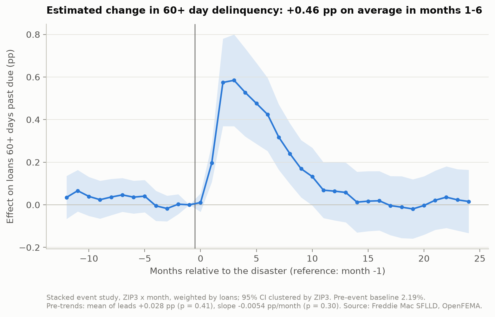
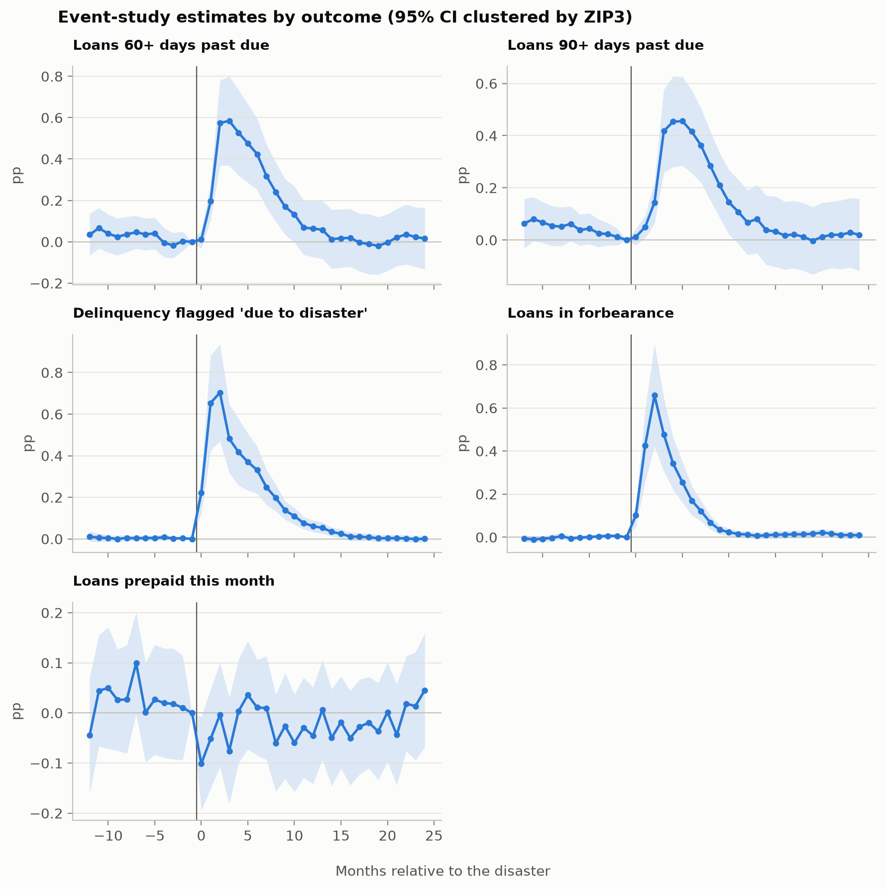

# Event study: climate disasters and mortgage delinquency

Generated by `python -m climrisk.causal.event_study`. Stacked event study, ZIP3 x month, weighted by loans, 95% CI clustered by ZIP3.

Interpretation requires parallel trends and no spillovers. Mean/slope lead tests do not test every possible pre-trend; non-rejection is not proof of validity. Grace-period hits need not belong to the same disaster. Repeated controls and loan weights determine the pooled estimand (D012-D013).

## Design

| item | value |
|---|---|
| stacks (event months) | 43 |
| treated ZIP3-events | 338 |
| distinct treated ZIP3 | 274 |
| control ZIP3 per stack (median) | 68 |
| first event | 2005-08 |
| last event | 2024-01 |
| rows (stack x ZIP3 x month) | 137627 |

## Main result

## Summary by outcome

| outcome | avg_effect_pp_k1_6 | se | baseline_pct | pre_mean_pp | pre_mean_p | pre_slope_pp_month | pre_slope_p | n_obs |
|---|---|---|---|---|---|---|---|---|
| dlq60 | 0.464 | 0.089 | 2.193 | 0.028 | 0.41 | -0.0054 | 0.30 | 137627 |
| dlq90 | 0.323 | 0.063 | 1.805 | 0.047 | 0.08 | -0.0059 | 0.23 | 137627 |
| disaster_flag | 0.493 | 0.087 | 0.053 | 0.005 | 0.35 | -0.0003 | 0.76 | 137627 |
| forbearance | 0.388 | 0.071 | 0.030 | -0.001 | 0.81 | 0.0015 | 0.12 | 137627 |
| prepaid | -0.013 | 0.039 | 1.200 | 0.025 | 0.53 | 0.0005 | 0.91 | 137627 |

## Robustness: treatment threshold (dlq60)

| threshold | treated_events | avg_effect_pp_k1_6 | se | pre_mean_p | pre_slope_p |
|---|---|---|---|---|---|
| 0.5 | 338 | 0.464 | 0.089 | 0.41 | 0.30 |
| 0.75 | 290 | 0.499 | 0.094 | 0.57 | 0.37 |
| 0.9 | 257 | 0.575 | 0.106 | 0.84 | 0.66 |

## Coefficients (dlq60)

| rel_month | estimate_pp | se | ci_low | ci_high |
|---|---|---|---|---|
| -12 | 0.035 | 0.051 | -0.066 | 0.136 |
| -11 | 0.066 | 0.050 | -0.032 | 0.164 |
| -10 | 0.039 | 0.047 | -0.052 | 0.131 |
| -9 | 0.024 | 0.045 | -0.065 | 0.113 |
| -8 | 0.036 | 0.043 | -0.049 | 0.121 |
| -7 | 0.046 | 0.040 | -0.033 | 0.126 |
| -6 | 0.036 | 0.039 | -0.041 | 0.113 |
| -5 | 0.040 | 0.039 | -0.035 | 0.116 |
| -4 | -0.005 | 0.036 | -0.076 | 0.066 |
| -3 | -0.018 | 0.031 | -0.078 | 0.043 |
| -2 | 0.003 | 0.024 | -0.044 | 0.050 |
| -1 | 0.000 | 0.000 | 0.000 | 0.000 |
| 0 | 0.010 | 0.022 | -0.033 | 0.054 |
| 1 | 0.196 | 0.045 | 0.107 | 0.285 |
| 2 | 0.575 | 0.105 | 0.369 | 0.780 |
| 3 | 0.584 | 0.110 | 0.369 | 0.800 |
| 4 | 0.527 | 0.105 | 0.320 | 0.734 |
| 5 | 0.476 | 0.097 | 0.286 | 0.666 |
| 6 | 0.424 | 0.088 | 0.252 | 0.596 |
| 7 | 0.318 | 0.078 | 0.164 | 0.471 |
| 8 | 0.240 | 0.072 | 0.098 | 0.382 |
| 9 | 0.169 | 0.068 | 0.035 | 0.304 |
| 10 | 0.132 | 0.069 | -0.003 | 0.268 |
| 11 | 0.069 | 0.067 | -0.062 | 0.199 |
| 12 | 0.064 | 0.070 | -0.073 | 0.201 |
| 13 | 0.058 | 0.071 | -0.082 | 0.198 |
| 14 | 0.012 | 0.073 | -0.130 | 0.155 |
| 15 | 0.017 | 0.072 | -0.124 | 0.158 |
| 16 | 0.019 | 0.071 | -0.120 | 0.158 |
| 17 | -0.004 | 0.071 | -0.143 | 0.135 |
| 18 | -0.011 | 0.074 | -0.156 | 0.134 |
| 19 | -0.019 | 0.071 | -0.159 | 0.120 |
| 20 | -0.003 | 0.070 | -0.141 | 0.134 |
| 21 | 0.021 | 0.071 | -0.118 | 0.160 |
| 22 | 0.036 | 0.074 | -0.109 | 0.181 |
| 23 | 0.023 | 0.073 | -0.121 | 0.167 |
| 24 | 0.016 | 0.076 | -0.133 | 0.164 |
