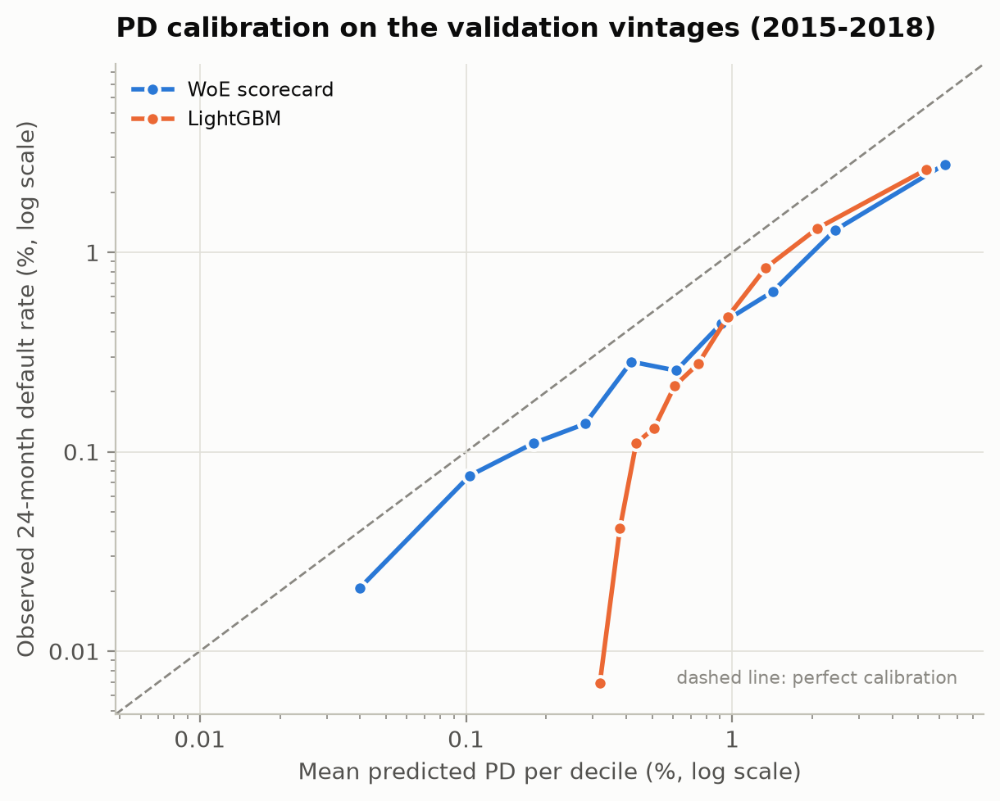

# PD calibration on the validation vintages

Generated by `python -m climrisk.models.calibration`. Models fitted on the training vintages (2004-2014); calibration measured on the validation vintages (2015-2018).

## Level and slope

Perfect calibration: observed / predicted = 1, a = 0, b = 1. a is the shift of logit(PD) that makes the mean PD equal the observed rate (a < 0: PDs too high). b < 1: PDs too extreme; b > 1: PDs too flat.

| model | mean_pd_pct | default_rate_pct | observed / predicted | a (level) | b (slope) |
|---|---|---|---|---|---|
| WoE scorecard | 1.269 | 0.602 | 0.47 | -0.771 | 0.908 |
| LightGBM | 1.275 | 0.602 | 0.47 | -0.771 | 1.136 |

## Reliability table: WoE scorecard

| decile | loans | defaults | mean_pd_pct | default_rate_pct | observed / predicted |
|---|---|---|---|---|---|
| 1 | 14475 | 3 | 0.040 | 0.021 | 0.52 |
| 2 | 14475 | 11 | 0.103 | 0.076 | 0.74 |
| 3 | 14475 | 16 | 0.179 | 0.111 | 0.62 |
| 4 | 14475 | 20 | 0.280 | 0.138 | 0.49 |
| 5 | 14475 | 41 | 0.418 | 0.283 | 0.68 |
| 6 | 14475 | 37 | 0.616 | 0.256 | 0.42 |
| 7 | 14475 | 64 | 0.913 | 0.442 | 0.48 |
| 8 | 14475 | 92 | 1.418 | 0.636 | 0.45 |
| 9 | 14475 | 187 | 2.431 | 1.292 | 0.53 |
| 10 | 14475 | 401 | 6.292 | 2.770 | 0.44 |

## Reliability table: LightGBM

| decile | loans | defaults | mean_pd_pct | default_rate_pct | observed / predicted |
|---|---|---|---|---|---|
| 1 | 14475 | 1 | 0.318 | 0.007 | 0.02 |
| 2 | 14475 | 6 | 0.379 | 0.041 | 0.11 |
| 3 | 14475 | 16 | 0.436 | 0.111 | 0.25 |
| 4 | 14475 | 19 | 0.508 | 0.131 | 0.26 |
| 5 | 14475 | 31 | 0.608 | 0.214 | 0.35 |
| 6 | 14475 | 40 | 0.745 | 0.276 | 0.37 |
| 7 | 14475 | 69 | 0.964 | 0.477 | 0.49 |
| 8 | 14475 | 121 | 1.334 | 0.836 | 0.63 |
| 9 | 14475 | 191 | 2.087 | 1.320 | 0.63 |
| 10 | 14475 | 378 | 5.375 | 2.611 | 0.49 |
