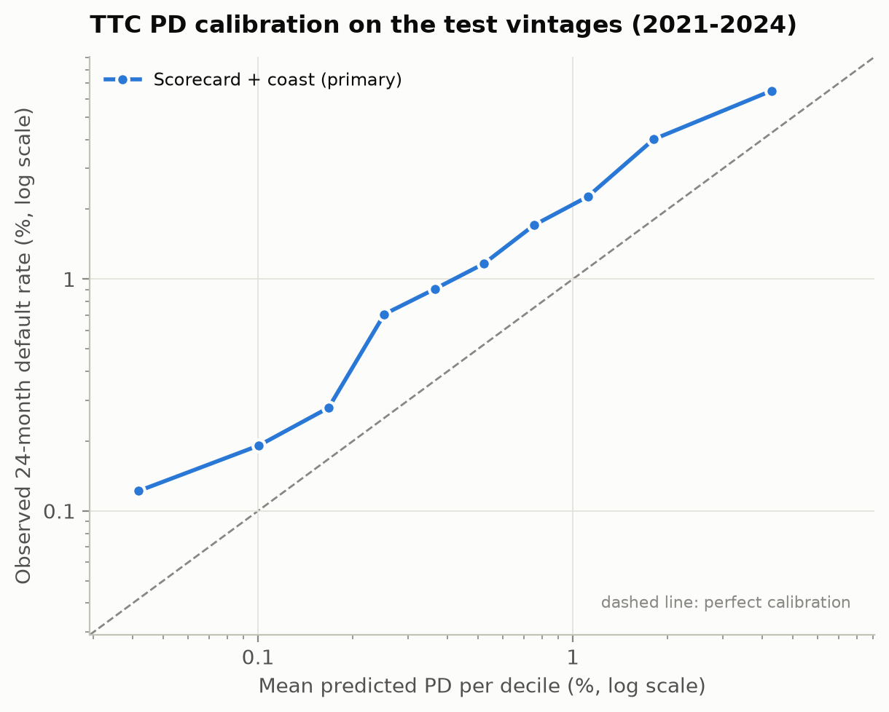

# Final PD evaluation on the test vintages

Generated by `python -m climrisk.models.final`. Models and features pre-registered in D021 before the test vintages were used. Refit on 2004-2018 (619,118 loans); test = 2021-2024 (114,822 loans, 2,049 defaults). LightGBM uses 41 trees (early stopping on validation). 95% bootstrap intervals over test loans (500 resamples; ZIP3 dependence not included).

## Discrimination

| model | auc | auc_low | auc_high | gini | gini_low | gini_high | ks |
|---|---|---|---|---|---|---|---|
| Scorecard + coast (primary) | 0.7820 | 0.7737 | 0.7917 | 0.5640 | 0.5474 | 0.5833 | 0.4305 |
| Scorecard (base) | 0.7823 | 0.7738 | 0.7916 | 0.5645 | 0.5476 | 0.5833 | 0.4301 |
| LightGBM (base) | 0.7973 | 0.7891 | 0.8059 | 0.5946 | 0.5782 | 0.6119 | 0.4717 |

## AUC differences (paired)

| comparison | auc_diff | ci_low | ci_high |
|---|---|---|---|
| Scorecard + coast (primary) - Scorecard (base) | -0.0002 | -0.0008 | +0.0003 |
| LightGBM (base) - Scorecard (base) | +0.0150 | +0.0106 | +0.0198 |

## Climate features in the primary model

| feature | iv_2004_2018 | status |
|---|---|---|
| near_coast_share | 0.0399 | kept |
| log_dist_coast | 0.0633 | kept |

## Calibration of the primary TTC PD

Long-run (TTC) rate 2004-2018: 1.105%. Mean TTC PD on test: 0.939%; observed default rate: 1.785% (observed / predicted 1.90). Level shift needed on test a = +0.670; slope b = 0.844.

### By vintage

| vintage | loans | defaults | default_rate_pct | mean_ttc_pd_pct | observed / predicted |
|---|---|---|---|---|---|
| 2021 | 7934 | 94 | 1.18 | 0.89 | 1.33 |
| 2022 | 49735 | 908 | 1.83 | 0.89 | 2.05 |
| 2023 | 49719 | 886 | 1.78 | 0.98 | 1.82 |
| 2024 | 7434 | 161 | 2.17 | 1.03 | 2.11 |

### By decile of TTC PD

| decile | loans | defaults | mean_pd_pct | default_rate_pct | observed / predicted |
|---|---|---|---|---|---|
| 1 | 11483 | 14 | 0.042 | 0.122 | 2.92 |
| 2 | 11482 | 22 | 0.101 | 0.192 | 1.90 |
| 3 | 11482 | 32 | 0.168 | 0.279 | 1.66 |
| 4 | 11482 | 81 | 0.252 | 0.705 | 2.80 |
| 5 | 11482 | 104 | 0.364 | 0.906 | 2.49 |
| 6 | 11482 | 134 | 0.522 | 1.167 | 2.23 |
| 7 | 11482 | 196 | 0.752 | 1.707 | 2.27 |
| 8 | 11482 | 261 | 1.118 | 2.273 | 2.03 |
| 9 | 11482 | 460 | 1.805 | 4.006 | 2.22 |
| 10 | 11483 | 745 | 4.271 | 6.488 | 1.52 |
