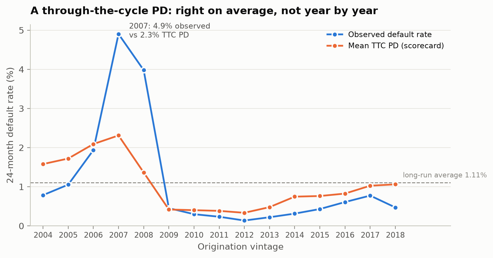

# Through-the-cycle PD anchoring

Generated by `python -m climrisk.models.ttc`. Scorecard refitted on the training and validation vintages (619,118 loans, 12 features kept). Test vintages not used.

## Anchoring

| quantity | value |
|---|---|
| Loan-weighted default rate, 2004-2018 (%) | 1.264 |
| Long-run rate: average of yearly rates (%) | 1.105 |
| Mean PD before anchoring (%) | 1.262 |
| Mean PD after anchoring (%) | 1.105 |
| Logit shift a | -0.141 |

## By vintage

observed / TTC PD > 1 means observed defaults exceed the model mean for that vintage. Residual differences may reflect the credit cycle, omitted variables or model error; they do not isolate a causal macroeconomic effect. This is a sample-based TTC proxy, not a regulatory calibration. Phase 8 explores stress scenarios.

| vintage | loans | defaults | default_rate_pct | mean_pd_raw_pct | mean_pd_ttc_pct | observed / ttc |
|---|---|---|---|---|---|---|
| 2004 | 49860 | 391 | 0.78 | 1.80 | 1.58 | 0.50 |
| 2005 | 49890 | 525 | 1.05 | 1.96 | 1.72 | 0.61 |
| 2006 | 49891 | 965 | 1.93 | 2.38 | 2.09 | 0.93 |
| 2007 | 49875 | 2445 | 4.90 | 2.63 | 2.31 | 2.12 |
| 2008 | 49865 | 1984 | 3.98 | 1.55 | 1.36 | 2.92 |
| 2009 | 44542 | 201 | 0.45 | 0.48 | 0.42 | 1.08 |
| 2010 | 35307 | 105 | 0.30 | 0.46 | 0.40 | 0.74 |
| 2011 | 34449 | 80 | 0.23 | 0.44 | 0.38 | 0.61 |
| 2012 | 32520 | 44 | 0.14 | 0.38 | 0.33 | 0.41 |
| 2013 | 35551 | 78 | 0.22 | 0.55 | 0.48 | 0.46 |
| 2014 | 42618 | 133 | 0.31 | 0.85 | 0.75 | 0.42 |
| 2015 | 45927 | 197 | 0.43 | 0.87 | 0.76 | 0.56 |
| 2016 | 47400 | 288 | 0.61 | 0.94 | 0.82 | 0.74 |
| 2017 | 48018 | 371 | 0.77 | 1.17 | 1.03 | 0.75 |
| 2018 | 3405 | 16 | 0.47 | 1.21 | 1.06 | 0.44 |
