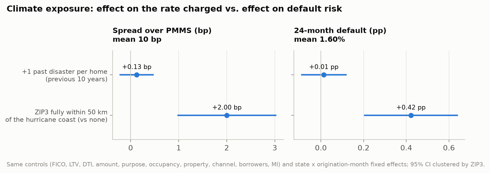

# Is climate risk priced?

Generated by `python -m climrisk.causal.pricing`. Spread = original rate minus the Freddie Mac PMMS 30-year average of the origination month (first payment - 2 months). 30-year non-HARP loans. Same controls in every regression; fixed effects state x origination month; 95% CI clustered by ZIP3. Associations conditional on observables, not causal effects.

## Coefficients

| regression | variable | unit | estimate | se | ci_low | ci_high | p_value | per_1_sd | outcome_mean | n_loans |
|---|---|---|---|---|---|---|---|---|---|---|
| Spread, all originations | exposure_main | bp | 0.108 | 0.164 | -0.215 | 0.430 | 0.512 | 0.113 | 12.935 | 753508 |
| Spread, all originations | near_coast_share | bp | 1.679 | 0.510 | 0.678 | 2.679 | 0.001 | 0.713 | 12.935 | 753508 |
| Spread, before 2012 | exposure_main | bp | -0.081 | 0.197 | -0.467 | 0.305 | 0.680 | -0.085 | 6.186 | 274582 |
| Spread, before 2012 | near_coast_share | bp | 2.362 | 0.609 | 1.166 | 3.558 | 0.000 | 1.004 | 6.186 | 274582 |
| Spread, from 2012 | exposure_main | bp | 0.288 | 0.212 | -0.129 | 0.704 | 0.176 | 0.301 | 16.804 | 478884 |
| Spread, from 2012 | near_coast_share | bp | 1.249 | 0.613 | 0.046 | 2.453 | 0.042 | 0.531 | 16.804 | 478884 |
| Spread, PD sample | exposure_main | bp | 0.127 | 0.174 | -0.214 | 0.468 | 0.465 | 0.133 | 10.468 | 564867 |
| Spread, PD sample | near_coast_share | bp | 2.004 | 0.518 | 0.987 | 3.020 | 0.000 | 0.852 | 10.468 | 564867 |
| 24-month default, PD sample | exposure_main | pp | 0.014 | 0.053 | -0.090 | 0.117 | 0.795 | 0.014 | 1.597 | 564867 |
| 24-month default, PD sample | near_coast_share | pp | 0.422 | 0.110 | 0.205 | 0.638 | 0.000 | 0.179 | 1.597 | 564867 |
| 24-month default, before 2012 | exposure_main | pp | 0.004 | 0.089 | -0.170 | 0.179 | 0.960 | 0.005 | 2.254 | 274048 |
| 24-month default, before 2012 | near_coast_share | pp | 0.584 | 0.185 | 0.221 | 0.947 | 0.002 | 0.248 | 2.254 | 274048 |
| 24-month default, from 2012 | exposure_main | pp | 0.038 | 0.032 | -0.025 | 0.101 | 0.238 | 0.040 | 0.979 | 290780 |
| 24-month default, from 2012 | near_coast_share | pp | 0.258 | 0.115 | 0.032 | 0.484 | 0.025 | 0.110 | 0.979 | 290780 |

`estimate` is per unit of the variable (+1 expected past disaster per home; ZIP3 share near the coast from 0 to 1); `per_1_sd` rescales it to one standard deviation of the variable in the pricing sample.

## Scale of the climate variables (pricing sample)

| variable | mean | std |
|---|---|---|
| exposure_main | 0.766 | 1.047 |
| near_coast_share | 0.253 | 0.425 |
